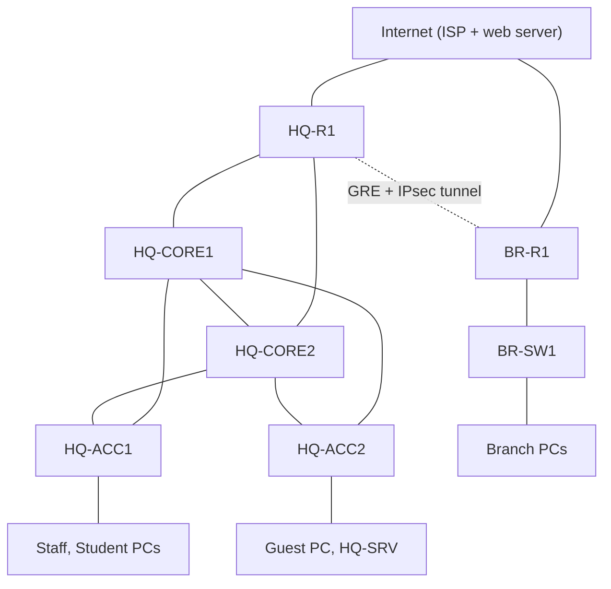
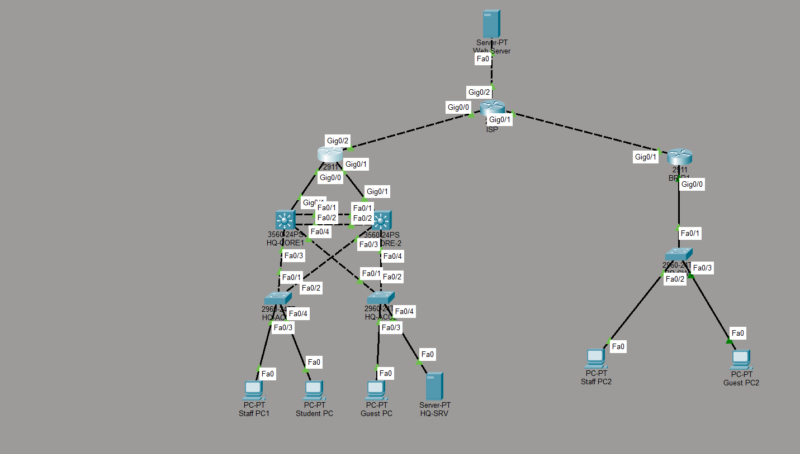

# CampusNet Pro: Resilient Two-Site Enterprise Network

A two-site enterprise network built and tested in **Cisco Packet Tracer 8.x**. The head office has a redundant Layer 3 core. The branch connects over a GRE/IPsec tunnel. Users get role-based access (Staff, Student, Guest), and every device is hardened. Failover and security behaviour were tested and documented with screenshots.

> Built as a CCNA (200-301) portfolio project. Based on a guided lab and then extended and debugged by me. The problems I hit and fixed are in [docs/problem-log.md](docs/problem-log.md).

## Topology




Full Packet Tracer view: `diagrams/topology.png`. Packet Tracer file: `CampusNet-Pro.pkt`.

## What is implemented

| Area | Implementation |
|---|---|
| Layer 2 | VLANs 10/20/30/40/99, 802.1Q trunks with allowed-VLAN lists, unused native VLAN 999, DTP off, LACP EtherChannel between cores |
| Loop prevention | Rapid-PVST+, CORE1 root (4096) and CORE2 backup (8192), root guard on core downlinks, BPDU guard and PortFast on edge ports |
| Gateway redundancy | Two Layer 3 cores with SVIs, HSRP (CORE1 active, preempt, interface tracking) |
| Routing | OSPF area 0 with passive interfaces, default route originated from the edge router, MD5 authentication on the internal routed links (the GRE tunnel is protected by IPsec) |
| IP services | DHCP with relay to a loopback on the edge router, DNS and web servers, NAT/PAT |
| WAN | Simulated ISP, GRE tunnel carrying OSPF, IPsec (AES-256, SHA, pre-shared key) |
| Access control | Four stateless-safe extended ACLs (Student, Guest, Servers, Branch Guest) plus an edge ACL (anti-spoofing, VPN-only inbound) |
| Hardening | SSH v2 only (2048-bit RSA), VTY access-class, console login, login block, port security (sticky), DHCP snooping, unused ports shut in black-hole VLAN |

| Time and logs | NTP from the edge router, syslog to a server, timestamps on all devices |
| IPv6 | Dual-stack IPv6 on the servers VLAN, the core link and the tunnel, with static routes (to the branch staff LAN) |

## CCNA 200-301 coverage

| Exam domain | Where it is shown |
|---|---|
| Network fundamentals | Addressing plan, subnetting, topology design |
| Network access | VLANs, trunks, LACP, Rapid-PVST+ |
| IP connectivity | OSPF, static and default routes, HSRP |
| IP services | DHCP relay, NAT/PAT, DNS |
| Security fundamentals | ACLs, port security, DHCP snooping, SSH, VPN |
| Automation | Python baseline-config generator in `scripts/` |

## Design decisions

- **Two cores with HSRP and tracking.** One core is a single point of failure. If CORE1 loses its uplink, its priority drops, CORE2 takes over and still has a path to the Internet.
- **CORE1 is both STP root and HSRP active.** Layer 2 and Layer 3 paths match, so traffic does not cross the core link needlessly.
- **DHCP relay points to a loopback on HQ-R1.** The loopback stays up while the router is up, so one failed link does not break DHCP.
- **ACLs include return-traffic rules.** Extended ACLs are stateless, so each role also permits echo-reply, `tcp established` and DHCP. This lets Staff support students without letting students start connections to Staff.
- **GRE with IPsec.** GRE carries OSPF multicast, which plain IPsec cannot, and IPsec encrypts the GRE packets.
- **Servers VLAN has its own ACL.** A compromised server can answer requests but cannot start connections to inside networks.

## Access policy (RBAC)

| Role | Allowed | Blocked |
|---|---|---|
| Staff (VLAN 10) | Everything | Nothing |
| Student (VLAN 20) | DNS and web on HQ-SRV, Internet | Staff, guests, branch, ping to server, all network devices |
| Guest (VLAN 30) | DNS on HQ-SRV, Internet | Everything inside the company, including the internal web page |
| Servers (VLAN 40) | Replies only, Internet | Starting connections to inside networks |

Details: [docs/rbac-policy.md](docs/rbac-policy.md). Addressing: [docs/addressing-table.md](docs/addressing-table.md).

## Verification

A written test plan with expected results and evidence is in [docs/test-results.md](docs/test-results.md). Screenshots are in `screenshots/`.

Note on ACL evidence: in this Packet Tracer version, the `ip access-group` binding on the Layer 3 switch VLAN interfaces is enforced but is not shown in `show running-config` or `show ip interface`. Enforcement is verified with ACL match counters (`show access-lists`) and with blocked and permitted traffic tests.

Highlights:
- Guest and Student ACLs block internal access while Internet access keeps working.
- OSPF neighbours reach FULL, including across the GRE tunnel.
- IPsec security association shows `QM_IDLE`.
- HSRP, spanning tree and EtherChannel states match the design.
- Security tests: SSH works, Telnet is refused, and an untrusted device is blocked by port security and DHCP snooping.

## Problems I solved

1. **ACLs looked unapplied.** Students and guests reached everything, and `show running-config` showed no `ip access-group` on the VLAN interfaces. Match counters in `show access-lists` proved the ACLs were enforced, so the binding is hidden by the simulator.
2. **OSPF did not form over the GRE tunnel.** Tracert left through the ISP instead of the tunnel. The tunnel interface was passive, and this Packet Tracer version rejected `no passive-interface` for it, so I made the other interfaces passive one by one instead.
3. **Edge ACL on the wrong device.** It was pasted on a core switch, and the `log` keyword was rejected. I moved it to the edge router and used an explicit final `deny ip any any` with match counters.
4. **OSPF key not supported on the tunnel interface.** I kept MD5 on the internal links and relied on IPsec to protect the tunnel.

Write-ups with symptoms, checks and fixes: [docs/problem-log.md](docs/problem-log.md).

## Limitations and future work

- Packet Tracer has no wired 802.1X or Dynamic ARP Inspection, so these are not claimed.
- Single edge router and a single WAN link at each site. Next step: a second ISP or backup tunnel.
- OSPF MD5 is on the internal links only; Packet Tracer does not accept the key on the tunnel interface (IPsec protects it).
- The edge ACL has no `log` keyword (not supported here), so drops are visible as match counters, not log entries.
- IPv6 first-hop redundancy is not configured: the IPv6 gateway for the servers VLAN exists on HQ-CORE1 only.
- STP priority is not set for VLAN 999 (unused native VLAN), so root guard logs a harmless message at boot.
- HSRP authentication, AAA with RADIUS or TACACS+, and SNMP monitoring are not configured.
- Python tooling here generates configs. Live backup automation (Netmiko) needs a platform that supports SSH from a host, such as GNS3 or EVE-NG.

## Repository layout

```
CampusNet-Pro.pkt          Packet Tracer file
README.md
diagrams/                  topology picture
configs/                   sanitised running configs (one file per device)
docs/                      addressing table, RBAC policy, test results, problem log
screenshots/               evidence for every test
scripts/                   gen_baseline.py, sanitize_configs.py
```

## How to reproduce

1. Open `CampusNet-Pro.pkt` in Cisco Packet Tracer 8.x.
2. Check addressing against `docs/addressing-table.md`.
3. Run the tests in `docs/test-results.md`.
4. Configs in `configs/` have secrets replaced with `<lab-secret>`. Set your own lab passwords before pasting them.

## Tech stack

Cisco IOS, Packet Tracer, VLAN, RSTP, HSRP, EtherChannel (LACP), OSPF, NAT/PAT, ACL, GRE, IPsec, DHCP/DNS, SSH, Python.
